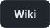
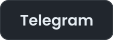
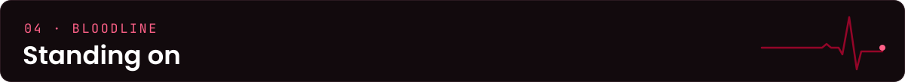
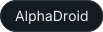
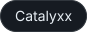
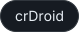
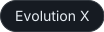
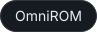

<div align="center">


The ROM that defined customization is back. Rebuilt on LineageOS 24 with **Remixer** at its heart, plus the best ideas from the ROMs we love, made to feel like RR.

<a href="https://resurrectedremix.com/#devices"></a>
<a href="https://wiki.resurrectedremix.com/"></a>
<a href="https://t.me/+qLz0jQ_ERZRlM2Ux"></a>
<a href="https://github.com/ResurrectedRemixOS/manifest"></a>

</div>

<br>


Also inside: Game Space, Haptic Remix, Nightstand, edge lighting, big folders and recents styles, network traffic styles, three-finger swipe, a ringtone for each SIM, Sense face unlock, OmniJaws weather, Remix backup and the floating sidebar.


<!-- gen:devices -->

| Device | Codename | Maintainer | Status | Help |
|---|---|---|---|---|
| OnePlus 13 | `dodge` | [OscarM1019](https://github.com/osm1019) |  | [Telegram](https://t.me/OP13CustomRoms/3) |
| OnePlus 11 | `salami` | [OscarM1019](https://github.com/osm1019) |  | [Telegram](https://t.me/OnePlus11CustomRoms/7739) |
| POCO F8 Ultra / Redmi K90 Pro Max | `myron` | [Kill3rEz](https://github.com/Kill3rEz) |  | [Telegram](https://t.me/rr_myron) |
| Pixel 9a | `tegu` | [OscarM1019](https://github.com/osm1019) |  |  |
| OnePlus 15 | `infiniti` | [OscarM1019](https://github.com/osm1019) |  | [Telegram](https://t.me/RROP15) |
| OnePlus 13R | `giulia` | [franlop77](https://github.com/chuspita) |  | [Telegram](https://t.me/franlop77_roms) |
| OnePlus Ace 5 | `giuliac` | [franlop77](https://github.com/chuspita) |  | [Telegram](https://t.me/franlop77_roms) |
| Redmi Note 10 Pro | `sweet` | [stahed](https://github.com/sm6150-dreams) |  | [Telegram](https://t.me/RedmiNote10ProCHAT) |
| POCO F7 | `onyx` | [jonhlcsgm](https://github.com/jonhlcsgm) |  | [Telegram](https://t.me/onyxmodding) |

<!-- /gen:devices -->

Every phone here is official, with a maintainer who tests each build on it. Want to bring yours back from the dead? Read the [requirements](https://github.com/ResurrectedRemix-Devices/official_devices) and apply.

<a href="https://github.com/ResurrectedRemix-Devices/official_devices"></a>


```bash
# sync
repo init -u https://github.com/ResurrectedRemixOS/manifest -b rr-17.0 --git-lfs
repo sync -c -d --no-clone-bundle --no-tags

# build
. build/envsetup.sh
lunch rr_<codename>-userdebug
mka bacon
```

Your device tree needs an `rr_<codename>.mk` that pulls in RR:

```makefile
$(call inherit-product, vendor/rr/config/common_full_phone.mk)

PRODUCT_NAME := rr_<codename>
RR_MAINTAINER := YourName
WITH_GMS := true
```

| Flag | Default | What it does |
|---|---|---|
| `WITH_GMS` | `true` | Google apps. `false` makes a vanilla build |
| `RR_MAINTAINER` | empty | Your name, shown in About phone and the update info |
| `TARGET_FACE_UNLOCK_SUPPORTED` | `true` on 64-bit | Sense face unlock. `false` leaves it out |
| `TARGET_EXCLUDES_AUDIOFX` | `false` | `true` leaves out AudioFX, for phones with their own sound effects |
| `TARGET_SUPPORTS_BLUR` | `true` | Window blur, which Liquid Glass needs. `false` only for GPUs that cannot blur |
| `TARGET_SUPPORTS_QUICK_TAP` | `true` | Quick Tap, double-tapping the back of the phone (with GMS) |
| `TARGET_INCLUDE_LIVE_WALLPAPERS` | `true` | Pixel live wallpapers (with GMS) |
| `TARGET_SCREEN_WIDTH`, `TARGET_SCREEN_HEIGHT` | `1080`, `1920` | Boot animation size |
| `TARGET_BOOTANIMATION_HALF_RES` | `false` | `true` plays the boot animation at half size |
| `TARGET_UNOFFICIAL_BUILD_ID` | empty | A tag added to the name of your unofficial builds |

Builds made without RR's signing keys are unofficial.



<a href="https://github.com/LineageOS"></a>
<a href="https://github.com/alphadroid-project"></a>
<a href="https://github.com/AxionAOSP"></a>
<a href="https://github.com/Project-Catalyxx"></a>
<a href="https://github.com/crdroidandroid"></a>
<a href="https://github.com/Evolution-X"></a>
<a href="https://github.com/Lunaris-AOSP"></a>
<a href="https://github.com/omnirom"></a>
<a href="https://github.com/SlimRoms"></a>
<a href="https://github.com/VoltageOS"></a>

And to the original Resurrection Remix team, who showed us what a ROM could be.

<div align="center"></div>
