<div align="center">



The ROM that defined customization is back. Rebuilt on LineageOS 24 with **Remixer** at its heart, plus the best ideas from the ROMs we love, made to feel like RR.

<a href="https://resurrectedremix.com/#devices"></a>
<a href="https://github.com/ResurrectedRemixOS/manifest">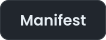</a>
<a href="https://github.com/ResurrectedRemix-Devices">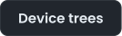</a>

</div>

<br>

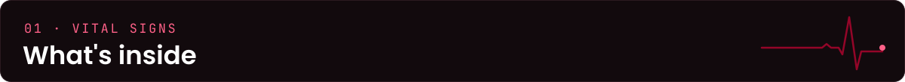

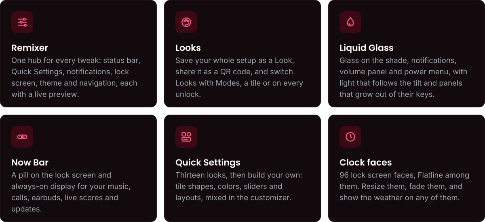

Also inside: boot animations, charge reports, Clear Voice, Remix backup, OmniJaws weather, Slim recents and the freeform sidebar.

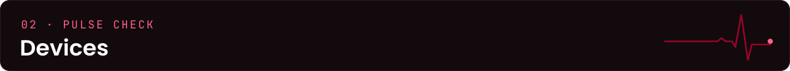

<!-- gen:devices -->

| Device | Codename | Maintainer | Status | Help |
|---|---|---|---|---|
| OnePlus 13 | `dodge` | [OscarM1019](https://github.com/osm1019) |  | [Telegram](https://t.me/OP13CustomRoms/3) |
| OnePlus 11 | `salami` | [OscarM1019](https://github.com/osm1019) |  | [Telegram](https://t.me/OnePlus11CustomRoms/7739) |
| tegu | `tegu` | [OscarM1019](https://github.com/osm1019) | In bring-up |  |

<!-- /gen:devices -->

Device trees, kernels and blobs live in [ResurrectedRemix-Devices](https://github.com/ResurrectedRemix-Devices). Want to bring your phone back from the dead? Read the [requirements](https://github.com/ResurrectedRemix-Devices/official_devices) and apply.

<a href="https://github.com/ResurrectedRemix-Devices/official_devices"></a>

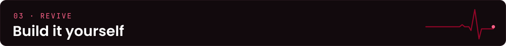

```bash
# sync
repo init -u https://github.com/ResurrectedRemixOS/manifest -b rr-17.0 --git-lfs
repo sync -c -d --no-clone-bundle --no-tags

# build
. build/envsetup.sh
brunch <device_codename>
```


<a href="https://github.com/LineageOS">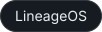</a>
<a href="https://github.com/alphadroid-project"></a>
<a href="https://github.com/AxionAOSP">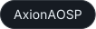</a>
<a href="https://github.com/Evolution-X"></a>
<a href="https://github.com/Lunaris-AOSP">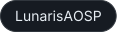</a>
<a href="https://github.com/omnirom"></a>
<a href="https://github.com/SlimRoms">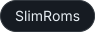</a>
<a href="https://github.com/VoltageOS">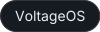</a>

And to the original Resurrection Remix team, who showed us what a ROM could be.

<div align="center"></div>
